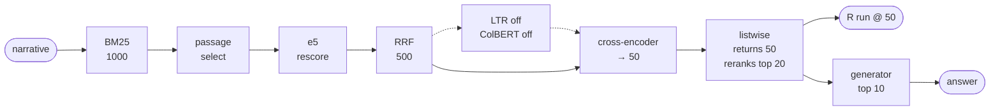
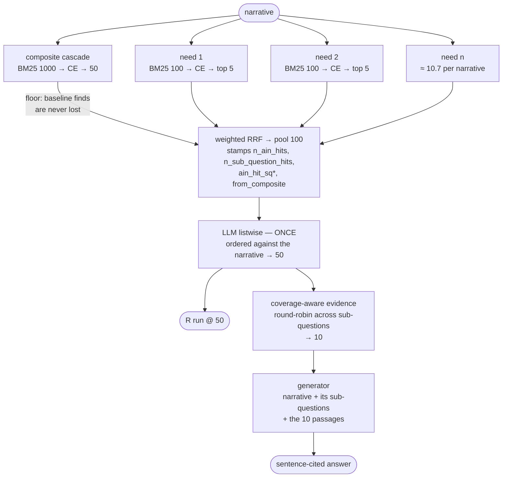
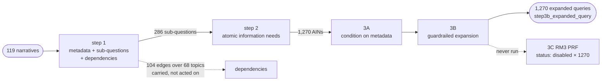
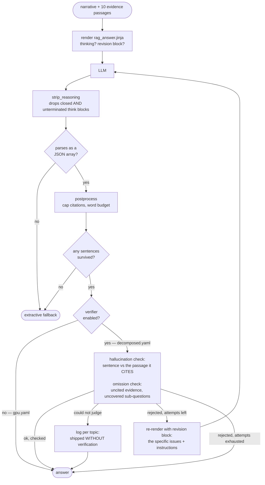
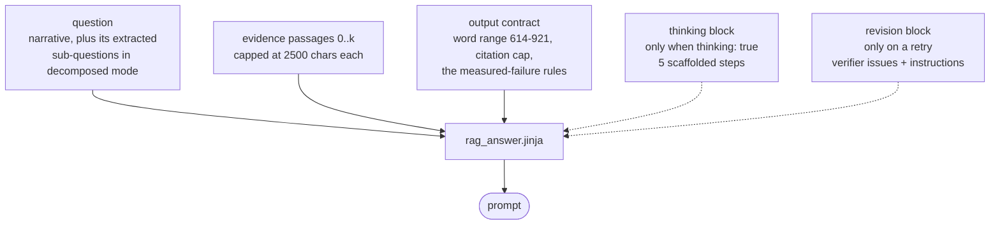
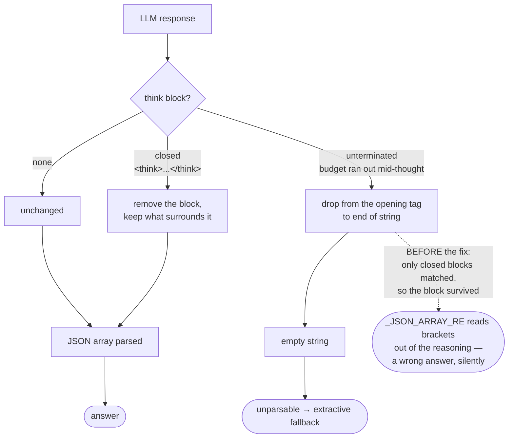
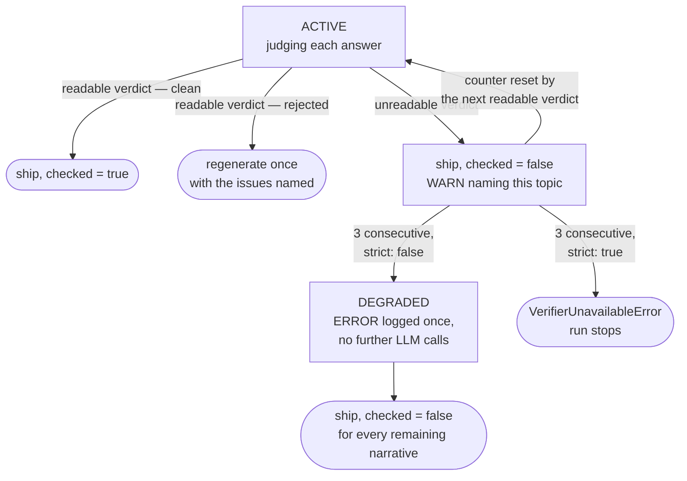

# Full pipeline — current state

Written 2026-08-07 against `nahid/bruteforce-approach` @ `545832a` **plus
uncommitted work** (see "What is not committed"). Deadline **Aug 8, 2026**.

This document is **what the pipeline does**. For how to install, configure and
run it, see **[RUNNING.md](RUNNING.md)**.

It supersedes `CURRENT_PIPELINE.md` (which describes `main`, before any of this)
as the description of what runs today. `PIPELINE_GAP_ANALYSIS.md` records what
was missing before this work; `RECENT_WORK.md` covers the 13 commits that
preceded it. Those three live in `.venv/rnd/`.

## Two arms, one cascade

The repo now ships two runtime modes over a single shared retrieval cascade.
Which one runs is decided by whether the config carries a `decomposition:`
block — nothing else changes.

**Composite arm** — `configs/pipeline.gpu.yaml`, the banked submission:



**Decomposed arm** — `configs/pipeline.decomposed.yaml`, new, never run live:



Both arms call the same `RagPipeline.retrieve()`. The decomposed arm builds two
instances of it over **shared** model objects (one e5, one cross-encoder) with
different depths, and holds listwise itself.

## Offline: query decomposition

Runs once per topic set, `Qwen2.5-72B-Instruct-AWQ` under vLLM, in the separate
`trec-rag-2026-vllm` conda env (vLLM pins torch and would downgrade it under the
validated pipeline). Committed output covers the **119 test narratives only**.



| Step | Produces | Result |
|---|---|---|
| 1 | `query_metadata`, `sub_questions`, `dependencies` | 119/119, **286 sub-questions**, 104 dependency edges over 68 topics, 0 flagged |
| 2 | `ain` — atomic information needs | 286 calls, **1,270 AINs**, mean 4.44 per sub-question, 0 flagged |
| 3A | `step3a_conditioned_query` | 1270/1270 first attempt |
| 3B | `step3b_expanded_query` | 1269 + 1 recovered, 0 flagged |
| 3C | `step3c_expanded_query` (RM3 PRF) | **never run** — `status: "disabled"` on all 1,270 |

Sub-question spread: 1×16, 2×67, 3×18, 4×11, 5×6, 8×1. The data does **not**
cap at two sub-questions, which several older notes assume.

**A trap in the 3C field.** `step3c_expanded_query` is populated even when PRF
did not run: with `step3c_prf_terms: []` the term-append returns the 3B string
verbatim. Reading the field alone would report a PRF run that never happened, so
the loader gates on `step3c_status` and a test asserts PRF is absent across all
1,270 records.

## The shared cascade

`RagPipeline.retrieve()` — [pipeline.py](src/trecrag/pipeline.py). Depths below
as *composite | per-need*.

| Stage | Depth | Backend |
|---|---|---|
| BM25 | 1000 \| 100 | Pyserini REST, `search_adaptive` for the API bug |
| Passage selection | no cut | lexical, CPU, 2×2000 chars, **score-ordered** |
| e5 rescore | no cut | `intfloat/e5-base-v2` |
| RRF | 500 \| 100 | k = 60 |
| LTR | **off** | — |
| ColBERT | **off** | — |
| Cross-encoder | → 50 | `cross-encoder/ms-marco-MiniLM-L-6-v2` |

Two things that are easy to get wrong:

- **A disabled stage still truncates** ([pipeline.py:104-107](src/trecrag/pipeline.py#L104-L107)):
  a `None` reranker does `candidates[:depth]`. LTR and ColBERT are off, so their
  `top_k` is pinned at pool size to cut nothing. Restoring the CPU config's 200
  and 100 silently re-imposes the cut with nothing doing the scoring.
- **Passage selection is load-bearing and absent from `Full-pipeline.md`.**
  ClimbMix returns whole books (median 42,948 chars; not one of 1,000 candidates
  under 2,000). Over 200 real candidates, the leading window was the best window
  in only 10, and the median best window started at char 15,900. Without it the
  whole cascade scores and cites each document's title page.

## Decomposed arm — `src/trecrag/decomposed/`

| Module | Responsibility |
|---|---|
| `schema.py` | `AtomicNeed` / `SubQuestion` / `DecomposedTopic`; emits plain `Topic`s so the cascade runs unmodified. `query_text()` degrades 3C → 3B → 3A → raw. |
| `loader.py` | Step-3 JSONL → objects. **Joins `ain` to `expanded_queries` on `(sub_question_id, ain_id)` and raises on any misalignment** — the two blocks come from separate script runs, and a bad join retrieves a well-formed query for the wrong need with nothing downstream able to notice. |
| `fusion.py` | Weighted RRF over per-need runs + the composite run. Stamps `n_ain_hits`, `n_sub_question_hits`, `ain_hit_sq<id>`, `from_composite`. |
| `evidence.py` | Coverage-aware evidence selection (below). |
| `orchestrator.py` | `DecomposedPipeline` — same `run_topic()` contract as `RagPipeline`. |

Two decisions carry this arm:

**Listwise runs once, on the pooled list.** It costs ~9.9 s a call against ~0.5 s
for the cross-encoder, and a narrative averages ~10.7 needs. Per-need listwise
would make one stage most of a multi-hour run to order candidate sets that are
about to be merged anyway.

**Evidence spans sub-questions, not the pool head.** Fusion rewards agreement,
and needs cluster inside sub-questions, so the top of the pool skews toward
whichever sub-question spawned the most needs. Selection round-robins across
sub-questions, rarest coverage first. Demonstrated on the real `rag2026-0`
decomposition with a deterministic retriever:

```
rank-order    : [sq1_doc0, sq1_doc1, sq1_doc2, sq1_doc3]  → covers sq1 only
coverage-aware: [sq1_doc0, sq1_doc1, sq1_doc2, sq2_only]  → covers sq1 + sq2
```

Without this, decomposing the query and then discarding the decomposition at the
last step leaves `WORK_LOG.md` §5.2's coverage failure exactly where it was.

**`DecomposedPipeline` exposes `run_topic(topic) -> (ranked, RagAnswer)`**, the
same as `RagPipeline`, so `scripts/run_pipeline.py`'s worker loop, per-topic
checkpointing, canonical-order assembly and `.partial` guard all work unchanged.

## Generation

The generator itself did not need replacing — it already took the composite
question plus evidence in one shot, which is what `Full-pipeline.md` Step 6
describes. What changed is the prompt, the reasoning, and what happens after.



### Prompts are Jinja templates

`src/trecrag/generation/templates/` — `rag_answer.jinja` and
`answer_verification.jinja`, rendered by `prompts.py` with `StrictUndefined`
(a mistyped variable fails loudly instead of rendering a prompt quietly missing
its word target). Every instruction in the answer template was an observed
failure over 119 narratives; a test pins them so they cannot be trimmed for
brevity.

Solid lines are always in the prompt; dashed blocks appear only under a
condition, which is the whole reason the prompt is a template rather than a
string:



### Thinking

Both prompts can ask for a `<think>` block first, with scaffolded steps:
enumerate the asks → map passages to each → plan conditional guidance where
evidence is thin → budget sentences across asks → confirm each claim traces to a
citation. The judge's scaffold is written for judging instead: support vs.
topic-match, paraphrase vs. drift, and that a sentence supported by a passage it
does **not** cite is still unsupported.

**This required hardening the strip.** `WORK_LOG.md` §4.4 records reasoning
tokens corrupting both parsers — which is why the project runs a non-reasoning
model. `strip_reasoning` only matched **closed** `<think>…</think>`; a block
truncated by the token budget kept no closing tag, passed through, and
`_JSON_ARRAY_RE` then read brackets out of the reasoning. It now also drops an
unterminated block to end-of-string, and token budgets rise when thinking is on
(generator 4096 → 6144, judge 512 → 1536) because the block is spent *before*
the payload.

The middle branch is the one that mattered — and note both failure paths lead
somewhere safe, while the old behaviour led somewhere wrong and silent:



### Verification and regeneration

`verifier.py`. Off by default in code; enabled in `pipeline.decomposed.yaml`.

- **`LexicalGroundingVerifier`** (default, free, no API call). Hallucination:
  per-sentence content-word overlap against the passage it *cites* — aimed at
  the measured failure, which §5.5 shows is **misattribution, not fabrication**
  (33 sentences matched a retrieved-but-uncited document). Omission: evidence
  never cited, plus sub-questions that have a passage in the pool but no
  citation. The overlap threshold is a floor, not a similarity score — raising it
  rejects legitimate paraphrase and buys a regeneration for nothing.
- **`LLMVerifier`** (opt-in). One judging call per answer; catches
  paraphrase-level fabrication overlap cannot.
- **`CompositeVerifier`** runs cheapest-first and short-circuits, so a draft the
  free check already rejects never pays for the judge.

A rejected draft is regenerated **once**, with the verifier's specific findings
injected into the prompt's revision block — "try again" reliably reproduces the
same answer.

**The failure mode this had to be protected against.** An unreadable judgement
is *passed through*, not failed (rejecting on the verifier's own parse errors
would regenerate good answers and ship the last draft anyway). That made "I
checked and it's clean" and "I couldn't check" the same value, so a broken judge
produced a run of unverified answers that read as a run of clean ones.
`VerificationResult.checked` now separates them, and:

- every answer shipping unverified is logged by topic id;
- an empty response after stripping is diagnosed specifically (it is the
  signature of a truncated think block) and the warning names `max_tokens`;
- after `max_consecutive_unparsable` (3) the verifier logs an ERROR and **stops
  calling** — each call is a generation-sized request, and 119 of them to learn
  the same thing is pure cost;
- `strict: true` raises instead of degrading. Left **false** in the config: this
  close to the deadline an aborted run costs more than an unverified one, and
  the ERROR is now impossible to miss. Worth flipping once there is time to fix
  and re-run.

The default `backends: ["lexical"]` cannot silently no-op — it makes no calls.
Only the opt-in LLM judge could, and that is now the loud path.

The verifier's own lifecycle across a 119-narrative run. Three of these four
states ship an answer; only one of them has actually checked it:



## Configs

| File | Mode | Generation |
|---|---|---|
| `pipeline.yaml` | composite | extractive, no thinking, no verification — dependency-free plumbing test |
| `pipeline.gpu.yaml` | composite | LLM, **no thinking, no verification** — the banked submission, byte-identical to before this work |
| `pipeline.assubmitted.yaml` | composite | snapshot of the banked run, for A/B |
| `pipeline.decomposed.yaml` | **decomposed** | LLM + thinking + lexical verification, `max_attempts: 2` |

`pipeline.gpu.yaml` was deliberately not touched. Enabling verification there
would change an artifact that has already been validated.

## Cost

Measured per narrative on the composite arm (2× RTX 6000 Ada / Xeon w9-3595X):

```
generation        34.10s   67.4%     ← the bottleneck
llm_listwise       9.89s   19.5%     (NOT the ~85% older notes claim)
biencoder          4.96s    9.8%
passage_selection  0.96s    1.9%
cross_encoder      0.45s    0.9%
bm25 (cached)      0.23s    0.5%     (4.23s cold)
total             50.59s             ~71 narratives/hour
```

Estimates for the decomposed arm, **not measured**: ~3 h for 119 narratives and
~15 GB of new response cache, given `per_ain.bm25_hits: 100`. At `hits: 1000`
per need it would be ~80 GB. Verification adds one full generation per rejected
draft; a run where every draft fails is ~1.7×.

## What is measured, and what is not

Measured, on the composite arm, over 22 dev narratives against three projected
UMBRELA assessor variants:

- full cascade beats BM25 by **+0.078 / +0.130 / +0.107** nDCG@10, monotonic
  across stages and all three assessors — but only on **condensed lists**.
  Scored naively BM25 appears to *win* (0.6840 vs 0.4957) because the judgment
  pool was built from BM25 output: `judged@10` is 100% for BM25 and 56.4% for
  the full cascade. Always pass `--condensed` **and** `--judged-rate`.
- Detectable difference on this dev set is **~0.04** (paired SE 0.014–0.023).
- `rerank_depth=20` costs nothing measurable and buys ~31% wall clock.

Not measured, and this is the honest bottom line:

- **The decomposed arm has never been run against the live service.**
- **It cannot be scored yet.** The committed decomposition covers the 119 test
  narratives; the 22 dev topics have integer ids (`14`, `31`, …) and **0 of 22**
  are covered. Steps 1–3 must be run over the dev topics first — a CLI run
  (`--topics` / `--input` / `--output` are all flags), but it needs both GPUs
  for the 39 GB AWQ load.
- **Answer quality is unmeasured for either arm.** `evaluate_nuggets.py` exists
  and has not been run.
- `per_ain.bm25_hits: 100` is an **untested assumption**. §5.3 measured depth
  1000 as load-bearing for the *composite* query, where BM25 rank barely
  predicts relevance (Spearman +0.032 vs +0.209 for e5). A need is narrow and
  precise so the argument is weaker — but nobody has checked.

## Running it

Full operating instructions — installation, the two conda environments, config
selection, script order and the known gotchas — are in **[RUNNING.md](RUNNING.md)**.
The two commands, for orientation:

```bash
conda activate trec-rag-2026

# composite (the banked path, unchanged)
python scripts/run_pipeline.py \
    --topics trec_rag_2026_test_query_set.tsv \
    --config configs/pipeline.gpu.yaml \
    --team-id iris-mst --run-id bruteforce-cascade \
    --out-dir output_baseline/ --workers 1

# decomposed — needs step-3 output covering THESE topics
python scripts/run_pipeline.py \
    --topics trec_rag_2026_test_query_set.tsv \
    --config configs/pipeline.decomposed.yaml \
    --team-id iris-mst --run-id decomposed-cascade \
    --out-dir output_decomposed/ --workers 1
```

Give the decomposed run a **distinct `run_id`** so both can be submitted and
told apart. A missing decomposition fails before any model loads, naming the
uncovered topics.
