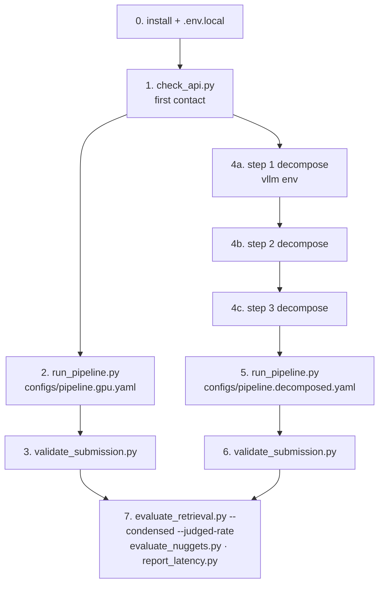

# Running the pipeline

End-to-end operating instructions: what to install, how the config files select
behaviour, and which scripts to run in what order.

`FULL_PIPELINE.md` (this folder) describes what the pipeline *does*. This
describes how to make it run. Written 2026-08-08.

---

## 1. Installation

### 1.1 Two conda environments, deliberately separate

vLLM pins torch. Installing it into the main environment downgrades torch
underneath a validated submission pipeline, so the decomposition preprocessors
live in their own environment and never share one with the retrieval cascade.

| Environment | Contains | Used by |
|---|---|---|
| `trec-rag-2026` | torch 2.11.0+cu128, sentence-transformers | everything except decomposition |
| `trec-rag-2026-vllm` | torch 2.9.0+cu128, vLLM 0.13.0 | `scripts/decompose/*` only |

```bash
# main environment
conda create -n trec-rag-2026 python=3.12 -y
conda activate trec-rag-2026
pip install -e ".[neural,llm]"

# decomposition environment (separate on purpose)
conda create -n trec-rag-2026-vllm python=3.12 -y
conda activate trec-rag-2026-vllm
pip install vllm==0.13.0
```

### 1.2 What the extras give you

`pyproject.toml` — base dependencies install unconditionally; extras are opt-in.

| Group | Packages | Needed for |
|---|---|---|
| base | `requests`, `PyYAML`, `numpy`, **`Jinja2>=3.1`** | everything |
| `neural` | `sentence-transformers`, `torch`, `transformers` | the e5 biencoder and cross-encoder (`backend: sentence_transformer`) |
| `llm` | `anthropic`, `openai` | only if you swap the OpenAI-compatible HTTP client for a vendor SDK; the Ollama path needs just `requests` |
| `ltr` | `lightgbm` | the LTR stage, which is currently **off** |
| `dev` | `pytest` | tests run under stdlib `unittest`, so this is optional |

**`Jinja2` is new and is a base dependency**, not an extra: the generator and
verifier prompts are templates under `src/trecrag/generation/templates/`, so the
package will not generate an answer without it. If you have an environment from
before this change, `pip install -e .` again.

### 1.3 Installed separately

**`pytrec_eval`** — required by `scripts/eval/evaluate_retrieval.py` and by
nothing else. It ships as an sdist and needs a compiler:

```bash
pip install pytrec_eval
```

**Ollama** — serves the listwise reranker and the generator. Its
OpenAI-compatible route is `/v1`.

```bash
ollama serve
ollama pull llama3.3:70b-instruct-q4_K_M
```

Use a **non-reasoning** model here. A reasoning model's inline `<think>` blocks
corrupt both the listwise rank parser and the generator's JSON parser;
`qwen3.5:35b` also returned empty through Ollama's OpenAI route. `strip_reasoning`
now handles both closed and truncated blocks, but the model choice is still the
first line of defence.

**Model weights** — `intfloat/e5-base-v2` and
`cross-encoder/ms-marco-MiniLM-L-6-v2` download on first use from HF.
`Qwen2.5-72B-Instruct-AWQ` is ~39 GB and needs **both** GPUs to load.

### 1.4 Dev evaluation data

The eval scripts default to a `trec-rag-data/` clone at the repo root, which is
**gitignored and absent** from a fresh checkout:

```bash
git clone https://github.com/TREC-RAG/trec-rag-data.git
```

`data/dev/` holds a committed partial copy — the three UMBRELA qrels variants
and the dev topics, but **not** the nuggets file. Either clone the full repo, or
point the scripts at the partial copy with `--qrels-dir data/dev/rag25-dev-umbrela-qrels`.
`evaluate_nuggets.py` needs the clone; there is no committed substitute.

### 1.5 Secrets

```bash
cp .env.local.example .env.local   # .env.local is gitignored
```

Fill in `PYSERINI_API_TOKEN` (request from `get-pyserini@googlegroups.com`).
Every script loads this file automatically via `trecrag.config.load_dotenv_local`.
Never pass these as CLI arguments — they end up in shell history and logs.

| Variable | Purpose |
|---|---|
| `PYSERINI_API_TOKEN` | ClimbMix search API |
| `LLM_BASE_URL` | `http://localhost:11434/v1` for Ollama |
| `LLM_API_KEY` | Ollama ignores it, but an empty value is rejected — keep the placeholder |
| `LLM_MODEL` | generator + verifier judge |
| `LLM_LISTWISE_MODEL` | listwise reranker |

---

## 2. Config files

Four configs. **The config is the only thing that selects which pipeline runs** —
per-AIN mode is chosen by the presence of a `decomposition:` block, not by a
flag.

| File | Mode | Backends | Use it for |
|---|---|---|---|
| `configs/pipeline.yaml` | composite | all dependency-free fallbacks; extractive generator | plumbing tests with no GPU, no keys, no models. **Not** a submission — listwise is a literal no-op |
| `configs/pipeline.gpu.yaml` | composite | real e5 + CE on GPU, Ollama | **the banked submission.** No thinking, no verification |
| `configs/pipeline.assubmitted.yaml` | composite | snapshot of the banked run | A/B baselines, so comparisons hit the real thing rather than a reconstruction |
| `configs/pipeline.decomposed.yaml` | **decomposed** | as gpu, plus thinking + verification | the per-AIN arm |

### Keys worth knowing before you change one

- **`stages.bm25.hits`** — the Pyserini cache key includes it, so changing it
  invalidates every cached payload and re-issues 119 searches at ~63 MB each.
  Pin it.
- **`stages.<stage>.enabled: false` still truncates.** A disabled stage applies
  its `top_k` (`candidates[:depth]`). LTR and ColBERT are off with `top_k` pinned
  at pool size so they cut nothing — lowering either silently re-imposes a cut
  with no stage scoring for it.
- **`decomposition.path`** must cover the topics you are running. Overridable at
  the CLI with `--decomposition`.
- **`decomposition.per_ain.bm25_hits: 100`** — not 1000. At full depth, 1,270
  needs would mean ~80 GB of new cache.
- **`generation.thinking`** — raises `max_tokens` 4096 → 6144 automatically.
- **`generation.verification.enabled`** — off in code by default; on in the
  decomposed config. A rejected draft costs one extra full generation.

---

## 3. Run order



Steps 2–3 and 4–6 are independent: the composite arm needs no decomposition, and
the decomposed arm does not need the composite run to have happened.

### 0. Sanity check

```bash
conda activate trec-rag-2026
python -m unittest discover -s tests -t .   # 413 tests, ~0.06s, no network
```

### 1. First contact with the search API

```bash
python scripts/check_api.py --config configs/pipeline.gpu.yaml
```

Confirms the token works and the index answers at depth 1000 before you spend an
hour discovering otherwise. Flags: `--query`, `--hits`.

### 2. Composite run — the baseline

```bash
python scripts/run_pipeline.py \
    --topics trec_rag_2026_test_query_set.tsv \
    --config configs/pipeline.gpu.yaml \
    --team-id iris-mst --run-id bruteforce-cascade \
    --out-dir output_baseline/ --workers 1
```

Writes `r_output_trec_rag_2026.tsv` and `rag_output_trec_rag_2026.jsonl`.
~80 min with GPUs free; 512 min observed under Ollama contention.

- **`--workers 1`.** The neural stages share one model instance each and
  concurrent forward passes are not thread-safe.
- **Resumable at two layers** — per-topic checkpoints in `<out-dir>/checkpoints`
  and the Pyserini response cache. Re-running the same command skips finished
  topics and costs no API calls. `--no-resume` forces recomputation.
- **A partial run cannot overwrite a complete submission.** `--limit` makes the
  run write `*.partial` instead of the official filenames.
- Logs and per-stage diagnostics land in `logs/` (`--log-dir`), inside the repo
  rather than beside the submission, so a run's history survives deleting the
  output directory.

### 3. Validate

```bash
python scripts/validate_submission.py \
    --retrieval output_baseline/r_output_trec_rag_2026.tsv \
    --rag output_baseline/rag_output_trec_rag_2026.jsonl \
    --topics trec_rag_2026_test_query_set.tsv
```

Checks the run-file format, per-topic coverage, citation and word limits, and
scans for leaked secrets. `metadata.narrative` is compared to the topics file
**byte-for-byte**.

### 4. Decomposition — the different environment

Needs both GPUs free for the 39 GB AWQ load (~4.7 min), then ~0.92 s/narrative.
**Run these in order; each consumes the previous one's output.**

```bash
conda activate trec-rag-2026-vllm

# 4a — metadata + sub-questions + dependencies
python scripts/decompose/preprocess_step1_decompose.py \
    --topics trec_rag_2026_test_query_set.tsv \
    --output output_decomp/preprocessed_queries_step1.jsonl

# 4b — atomic information needs
python scripts/decompose/preprocess_step2_decompose.py \
    --input  output_decomp/preprocessed_queries_step1.jsonl \
    --output output_decomp/preprocessed_queries_step2.jsonl

# 4c — 3A conditioning + 3B expansion. --no-prf skips 3C.
python scripts/decompose/preprocess_step3_decompose.py \
    --input  output_decomp/preprocessed_queries_step2.jsonl \
    --output output_decomp/preprocessed_queries_step3.jsonl \
    --no-prf
```

Each step writes a `*_flagged.jsonl` beside its output for records that failed
their gate. **Check it is empty before continuing** — a flagged record is one the
parser could not fully validate, and it is excluded from the main output rather
than written with a guessed value.

**On `--no-prf`.** `PRF_ENABLED = True` is the script default, so omitting the
flag runs step 3C: 1,270 live search calls paced at 1.5 s (~32 min of pacing
alone) against a service that has already produced one 429 storm. The committed
output was produced with `--no-prf`, and every record carries
`step3c_status: "disabled"`.

Common flags across all three: `--limit N` (first N topics, for a smoke test),
`--model`, `--tensor-parallel-size`, `--gpu-memory-utilization`, `--batch-size`.

### 5. Decomposed run

```bash
conda activate trec-rag-2026

python scripts/run_pipeline.py \
    --topics trec_rag_2026_test_query_set.tsv \
    --config configs/pipeline.decomposed.yaml \
    --team-id iris-mst --run-id decomposed-cascade \
    --out-dir output_decomposed/ --workers 1
```

Give it a **distinct `--run-id`** so both runs can be submitted and told apart.

The decomposition is validated against the topics **before any model loads** — a
topic with no decomposition fails immediately, naming the uncovered ids, rather
than after a multi-minute load. Extra flags: `--decomposition PATH` overrides
`decomposition.path`; `--per-ain-diagnostics` records every AIN's per-stage
diagnostics (~64× more records per topic, off by default).

Then validate exactly as in step 3, against `output_decomposed/`.

### 6. Evaluate

```bash
# retrieval quality — BOTH flags matter, see below
python scripts/eval/evaluate_retrieval.py \
    output_baseline/r_output_trec_rag_2026.tsv \
    output_decomposed/r_output_trec_rag_2026.tsv \
    --condensed --judged-rate

# answer coverage against gold nuggets (one LLM call per narrative)
python scripts/eval/evaluate_nuggets.py output_baseline/rag_output_trec_rag_2026.jsonl

# per-stage latency from the run's diagnostics
python scripts/eval/report_latency.py 'logs/stages_*.jsonl' --markdown
```

**`--condensed` and `--judged-rate` are not optional.** The judgment pool was
built from BM25 output, so unjudged documents — which score 0 — concentrate in
exactly the runs that rerank. Scored naively BM25 appears to *beat* the full
cascade (0.6840 vs 0.4957); `judged@10` is 100% for BM25 and 56.4% for the
cascade. Condensed lists compare systems only on documents assessors actually
saw, and reverse the ordering. A decomposed run surfaces even more unjudged
material, so this is where the trap bites hardest.

The detectable difference on this 22-topic dev set is **~0.04** nDCG@10.

---

## 4. Gotchas

**The dev topics have no decomposition.** The committed decomposition covers the
119 test narratives (`rag2026-*`). Dev topics use plain integer ids (`14`, `31`,
…) and **0 of 22** are covered. Evaluating the decomposed arm therefore means
running step 4 over `data/dev/topics/rag25-topics-dev.tsv` first:

```bash
python scripts/decompose/preprocess_step1_decompose.py \
    --topics data/dev/topics/rag25-topics-dev.tsv \
    --output output_decomp/dev_step1.jsonl
# ... steps 2 and 3 the same way, then:
python scripts/run_pipeline.py \
    --topics data/dev/topics/rag25-topics-dev.tsv \
    --config configs/pipeline.decomposed.yaml \
    --decomposition output_decomp/dev_step3.jsonl \
    --team-id iris-mst --run-id decomposed-dev --out-dir output_dev/
```

**Two narratives retrieve shallow.** A handful of ClimbMix documents kill the
API's response stream deterministically. `search_adaptive` walks the depth down
until the offending document falls outside the window: `rag2026-70` runs at
depth 10 and `rag2026-72` at 500, against 1000 for the other 117. The depth used
is recorded as a `bm25_depth` feature. This asymmetry should be stated in the
paper.

**Cache size.** ~63 MB per composite query at `hits: 1000` — budget ~7.5 GB for
119. The decomposed arm adds ~6.3 MB per need at `hits: 100`, so ~15 GB total.
Set `pyserini.cache_dir` somewhere with room.

**Ollama contention.** A shared Ollama host swapping models blocks requests
behind a multi-GB load; 578 s for one topic and a 300 s read timeout have both
been observed. The timeout is 900 s with retries.

**A run that logs `answer shipped WITHOUT verification`** means the judge could
not be read. Three consecutive occurrences disable the verifier for the rest of
the run with an ERROR naming the likely cause — usually `verification.max_tokens`
too low for the think block. Set `verification.strict: true` to make that stop
the run instead.
