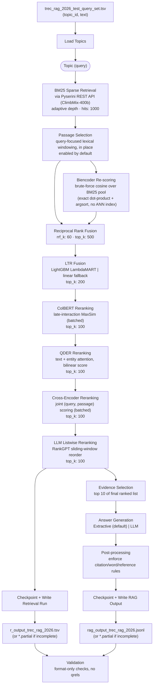

# TREC RAG 2026 Pipeline — Layer-by-Layer Overview

Branch: `nahid/qder-approach` (HEAD `ba74912`, plus uncommitted working-tree changes: an audit/hardening pass and 13 commits' worth of fixes ported over from the sibling `nahid/bruteforce-approach` branch). This document explains how a single query moves through the `trecrag` package, from the input topics file to the two official submission files, and how each layer is wired and configured.

## What this system is

`trecrag` is the submission pipeline for the TREC RAG 2026 track's RAG task. It retrieves from NVIDIA's **ClimbMix-400b** corpus via a hosted **Pyserini** (Lucene/BM25) REST API — there is no local corpus or persisted vector index anywhere in this repo, but there **is** a local, CPU-only, lexical passage-selection step (see layer 2.5 below). A query cascades through two first-stage retrievers (fused with RRF), a query-focused passage-selection rewrite, and six sequential rerankers, each narrowing the candidate pool, before a generator turns the final top passages into a sentence-cited answer. Every neural stage ships with a dependency-free fallback (hashing/lexical/identity) so the whole pipeline runs end to end with only `requests` + `PyYAML` + `numpy` — see [`README.md`](../README.md).

```
Query --> (BM25 + Biencoder) --> RRF fusion --> Passage Selection --> LTR --> ColBERT --> QDER --> Cross-Encoder --> LLM Listwise --> Generator
```

(Passage selection actually runs immediately after BM25, before the biencoder ever sees the pool — see layer 2.5 and the diagram below; it's placed after RRF fusion in the prose line above only because RRF is the more familiar landmark.)

## Pipeline diagram



Orchestration lives in one place: `RagPipeline.retrieve()` (`src/trecrag/pipeline.py:77-125`) runs the retrieval cascade above; `RagPipeline.run_topic()` (`pipeline.py:127`) then slices evidence and calls the generator. Every stage after BM25 is optional — passing `None` for a stage simply truncates to that stage's configured depth instead of scoring. `src/trecrag/factory.py::build_pipeline_from_config()` (`factory.py:241`) is the single place that reads a pipeline config YAML and wires concrete backend objects behind each stage's interface; it also runs a build-time consistency check, `_validate_output_depth()` (`factory.py:216`), that raises immediately if `retrieval_output.depth` exceeds any downstream stage's `top_k` — a config that used to silently cap the submitted depth now fails loudly instead.

## Layer-by-layer breakdown

### 0. Entry point & wiring
- **`scripts/run_pipeline.py`** — CLI: loads `.env.local` (`config.py:21`), loads a pipeline config YAML (`--config`, default `configs/pipeline.yaml`; `config.py:13`), loads topics, builds the pipeline via `factory.build_pipeline_from_config`, runs topics through a `ThreadPoolExecutor` (`--workers`, network-bound stages). The run is now **resumable and crash-safe**: every finished topic is checkpointed to `<out-dir>/checkpoints/` (`--work-dir` to override) via `TopicCheckpointStore` the moment it's produced; re-invoking the same command skips already-checkpointed topics (`--no-resume` to force recomputation); a topic that raises is logged and skipped rather than aborting the run; and a run that doesn't cover every topic in the input file (including a `--limit` smoke test) writes `<name>.partial` instead of the official filenames, so a partial run can never overwrite a complete submission. Logs are teed to `<out-dir>/run_<run-id>.log` by default (`--log-file` to override).
- **`scripts/check_api.py`** — a first-contact smoke test for the Pyserini API, meant to be run once a token arrives, before a real pipeline run: token validity, document-shape extraction (the single biggest silent-failure risk), whether `hits=1000` is actually honored, docid format, and measured cache size/runtime.
- **`src/trecrag/factory.py`** — translates every `stages.*.backend` config switch into a concrete object (`build_passage_selector`, `build_biencoder`, `build_ltr`, `build_colbert`, `build_qder`, `build_cross_encoder`, `build_llm_listwise`, `build_generator`) and assembles the `RagPipeline`, then runs `_validate_output_depth()`. No other module reads config directly.

### 1. Topic loading
- **`src/trecrag/data/topics.py::load_topics()`** (line 18) — parses a 2-column TSV (`topic_id \t text`), enforcing non-empty, unique topic IDs. Produces `Topic(topic_id, text)` (`schema.py:10`).

### 2. BM25 sparse retrieval
- **`src/trecrag/retrieval/bm25.py::BM25Retriever.retrieve()`** (line 16) calls **`src/trecrag/clients/pyserini_client.py::PyseriniClient.search_adaptive()`** (line 170) — not a plain `search()` call. `search_adaptive` tries the requested depth once, and if the request dies mid-body (a handful of specific ClimbMix documents deterministically break the API's response stream at any depth that includes them), it walks the depth down a halving ladder that always lands exactly on a floor (`min_hits`, default 10) rather than overshooting past it, so a narrative retrieved shallowly still makes it into the submission instead of being silently absent. `search()` itself (line 224) hits `GET /v1/{index}/search?query=...&hits=...`, but now:
  - **caches responses on disk**, keyed by a hash of `(index, query, hits)`, written via temp-file-then-atomic-rename so a killed process can't leave a corrupt cache entry;
  - retries **transport-level failures** (`ChunkedEncodingError`, `ConnectionError`, `Timeout`, a truncated-but-parseable `JSONDecodeError`) via `_get_json()` (line 131) with exponential backoff, since ~60 MB search payloads can drop mid-read after the status line was already accepted — something the status-code-based `urllib3.Retry` adapter can never see;
  - honors an explicit `Retry-After` header (`respect_retry_after_header=True`) on top of the adapter's own exponential backoff.

  Each hit becomes a `Candidate` with `features = {bm25_score, bm25_rank, bm25_depth}` — `bm25_depth` (new) records the depth actually used, so a shallow-retrieved narrative stays auditable rather than looking identical to a full-depth one. `_extract_text()` (`pyserini_client.py:61`) normalizes whatever shape the API returns a document in.
- Config: `stages.bm25.hits: 1000`; `pyserini.cache_dir`, `backoff_factor`, `max_retries`.

### 2.5. Query-focused passage selection
- **`src/trecrag/chunking.py::PassageSelector.apply()`** (line 103) — runs once, immediately after BM25 (`pipeline.py:85-86`), rewriting each `Candidate.text` in place to its most query-relevant span(s). ClimbMix documents are whole web pages/books (measured median ~43,000 chars, and not one of 1,000 sampled candidates was under 2,000 chars), and every downstream stage truncates its input to a short prefix — without this step, the whole cascade would rerank and cite each document's opening/title-page text regardless of where the actually-relevant content lives. `iter_windows()` (line 28) splits the document into overlapping fixed-size windows; `select_passage()` (line 48) scores each by length-normalized query-token overlap and keeps the top non-overlapping windows (2 per document by default, since these narratives bundle several sub-questions), re-joined in document order. Lexical, CPU-only, ~1.7s per 1000-candidate topic.
- Config: `stages.passage_selection.enabled: true` (on by default in this config), `window_chars: 2000`, `stride_chars: 1000`, `windows_per_doc: 2`, `min_doc_chars: 2000` (documents already at or below this size are left untouched).

### 3. Biencoder brute-force rescoring
- **`src/trecrag/retrieval/biencoder.py::BiencoderRetriever.rescore()`** (line 89) — "brute-force" means *exact*, not approximate: it encodes the query and every already-fetched (and now passage-selected) candidate's text, computes `scores = doc_vecs @ query_vec` (a plain numpy dot product over the whole pool), and takes `np.argsort(-scores)[:k]` for an exhaustive exact top-k. There is no FAISS/HNSW/ANN index anywhere in the repo — ClimbMix is only exposed through the BM25 REST index, so this stage re-scores that pool in embedding space rather than being an independent recall source.
- Two encoder backends (`Encoder` ABC, `biencoder.py:22`): `HashingEncoder` (default — deterministic blake2b bag-of-words hashing, no model) and `SentenceTransformerEncoder` (lazy-imports `sentence-transformers`, model `intfloat/e5-base-v2` by default). `Encoder` now exposes separate `encode_queries()`/`encode_passages()` methods (default: both call the shared `encode()`); `SentenceTransformerEncoder` overrides them to apply E5's required `"query: "`/`"passage: "` prefixes and takes `device`/`batch_size`/`max_passage_chars` for real GPU use.
- Config: `stages.biencoder.backend: hashing|sentence_transformer`, `pool_size: 1000`, `dims: 768`; real backend also: `device`, `batch_size`, `query_prefix`, `passage_prefix`.

### 4. RRF fusion
- **`src/trecrag/retrieval/hybrid.py::reciprocal_rank_fusion()`** (line 8) — merges the BM25 and biencoder ranked lists by `docid`: `fused_score(d) = Σ 1/(k_const + rank)` across the lists that contain `d`; unions each candidate's `features` dict so downstream stages see both `bm25_*` and `bien_*` signals; adds `features["rrf_score"]`; truncates to `top_k`.
- Config: `stages.hybrid.rrf_k: 60`, `top_k: 500`.

### 5. Learning-to-Rank (LTR)
- **`src/trecrag/rerank/ltr.py::LTRReranker.rerank()`** (line 61) — fuses the numeric features accumulated so far (`bm25_score`, `bm25_rank`, `bien_score`, `bien_rank`, `rrf_score`) into one `ltr_score`. Two backends: a trained LightGBM LambdaMART booster (`model_path`, trained offline via `scripts/train_ltr.py` against a qrels file) or, by default, a dependency-free per-feature min-max-normalized weighted sum (`_linear_fallback`, `ltr.py:50`) using `stages.ltr.weights`.
- Config: `stages.ltr.model_path: null` (linear fallback active), `top_k: 200`.

### 6. ColBERT late interaction
- **`src/trecrag/rerank/colbert.py::ColBERTReranker.rerank()`** (line 120) — per-token embeddings for query and each candidate, scored with **MaxSim** (`max_sim()`, line 100: `similarity = query_tokens @ doc_tokens.T`, sum of each query token's best-matching doc token). `TokenEncoder` backends: `HashingTokenEncoder` (default, one-hot hashed tokens — MaxSim degenerates to a lexical overlap proxy) or `TransformerTokenEncoder` (real HF encoder's `last_hidden_state`). Both now expose a batched `encode_tokens_batch()` (line 28/74) — the real backend pads a batch to one forward pass and slices each row back to its true attention-mask length, so padding never leaks into MaxSim; a full run's candidate scoring no longer costs one GPU call per document.
- Config: `stages.colbert.backend: hashing|transformer`, `max_query_tokens: 32`, `max_doc_tokens: 180`, `top_k: 100`; real backend also: `device`, `batch_size`.

### 7. QDER (Query-specific Document and Entity Representations)
Despite the name shape, **QDER is a reranker, not a query-rewriting step** — vendored from the SIGIR2025-QDER paper into `src/trecrag/rerank/qder/_vendor/` (unmodified except two import paths).
- **`src/trecrag/rerank/qder/reranker.py::QDERReranker.rerank()`** (line 236): normalizes the upstream `bm25_score` feature to `[0,1]` as scale signal `s`, calls the scorer, stores `features["qder_score"]`, then optionally interpolates with normalized BM25 (`score_hybrid = λ·bm25_norm + (1-λ)·qder_norm`, `hybrid_lambda` default `0.5` — a fixed stand-in for the paper's tuned λ, `_hybrid_scores`, line 260).
- Architecture (per-doc, `_score_one`/`QDERModel.forward`): query-guided softmax attention over doc tokens (and optionally entity mentions) → **Addition** (complementarity) + **Multiplication** (alignment) interactions → mean-pooled and scaled by `s` → bilinear scoring head.
- Two backends: `HashingQDERScorer` (`reranker.py:51` — same math, hashed vectors, **untrained/identity bilinear matrix** — `h @ h`) and `TransformerQDERScorer` (`reranker.py:106` — wraps vendored `QDERModel`, real BERT text channel, loads a checkpoint via `model_path` if given, otherwise untrained). No checkpoint has been trained yet; `scripts/prepare_qder_data.py` builds (query, doc, label) training data from this pipeline's own retrieval cascade plus a qrels file (dev topics/qrels now live in-repo under `data/dev/`), and the trainer itself is vendored in-repo at `third_party/qder_training/train.py` (see its `README.md` for the full train → unwrap-checkpoint → configure flow) — no sibling-repo dependency required.
- Entity channel: `src/trecrag/rerank/qder/entities.py` — `NullEntityProvider` (default, off) or `HeuristicEntityProvider` (regex capitalized-phrase spotting + hashed vectors, a stand-in since no WAT linker/Wikipedia2Vec table exists for ClimbMix). The regex-based extractor now correctly strips only a leading stopword instead of discarding the whole match (`"The Eiffel Tower"` → `"Eiffel Tower"`, not dropped entirely), and requires 2+ consecutive capitalized words (or a short all-caps acronym) rather than treating any sentence-initial capitalized word as an entity. `factory.py::build_qder` also now raises a clear config error if `use_entities: true` is set without `entity_provider: heuristic`, instead of silently building a model with an entity channel that only ever receives zero placeholder vectors.
- Pipeline placement: right after ColBERT, before the pairwise cross-encoder — a heavier, more precise multi-vector reranker slotting in after the cheap token-level ColBERT pass narrows the pool.
- Config: `stages.qder.backend: hashing|transformer`, `model_name: bert-base-uncased`, `use_entities: false`, `entity_provider: heuristic`, `hybrid_lambda: 0.5`, `top_k: 100`.

### 8. Cross-encoder
- **`src/trecrag/rerank/cross_encoder.py::CrossEncoderReranker.rerank()`** (line 78) — scores each `(query, passage)` pair jointly (not via separate embeddings). `LexicalOverlapScorer` fallback (normalized token-overlap) or `SentenceTransformersCrossEncoderScorer` (`sentence_transformers.CrossEncoder`, default model `cross-encoder/ms-marco-MiniLM-L-6-v2`). Both now expose a batched `score_batch()` (line 22/64); the real backend batches every scorable pair into one `CrossEncoder.predict()` call instead of one forward pass per candidate — measured at 500 candidates scored in 0.24s.
- Config: `stages.cross_encoder.backend: lexical|sentence_transformer`, `top_k: 100`; real backend also: `device`, `batch_size`, `max_passage_chars`.

### 9. LLM listwise reranking
- **`src/trecrag/rerank/llm_listwise.py::LLMListwiseReranker.rerank()`** (line 40) — RankGPT-style sliding window: processes the candidate list bottom-up in overlapping windows (`window_size: 20`, `step: 10`), prompts an LLM for a relevance-ordered permutation (`"[3] > [1] > [2]"`), parses it, splices the window back in, slides toward the top.
- **`_parse_order`** (line 94) was hardened and is now *stricter*, not more tolerant: it prefers bracketed indices (matching the requested format exactly); bare integers are only accepted as a fallback when they cover most of the window (otherwise they're indistinguishable from digits inside prose reasoning); and if it can't parse a confident permutation it returns `None`, which `_rank_window` (line 64) treats as "keep this window's input order and log a warning" rather than silently back-filling a guess. (Previously, *any* response — including pure prose — always produced *some* permutation, with no signal that it might be wrong.)
- LLM responses are also passed through `strip_reasoning()` (`llm_client.py`) before parsing, removing `<think>`/`<thinking>`/`<reasoning>` blocks a reasoning model might emit — both this parser and the generator's JSON parser are positional/pattern-based and would otherwise silently corrupt on stray digits/brackets inside a chain-of-thought block.
- With the default `IdentityLLMClient` (empty completions), every window's response is unparsable and falls back to input order — this stage is a safe no-op until a real `openai`/`anthropic` backend is configured.
- Config: `stages.llm_listwise.backend: identity|openai|anthropic`, `max_passage_chars: 300`, `top_k: 100`. **This produces the final ranked list.**

### 10. Evidence selection & answer generation
- `RagPipeline.run_topic()` (`pipeline.py:127-136`) takes `evidence = final_ranked[:evidence_k]` (default 10) and calls the `Generator`.
- **`src/trecrag/generation/generator.py`**: `ExtractiveGenerator` (default, zero-dependency) — for each evidence passage, picks the sentence with highest query-token overlap (`_best_sentence`, line 71) and cites that passage; always grounded by construction. `LLMGenerator` (line 86) — prompts an LLM to write a JSON array of `{"text", "citations"}` objects using only the evidence passages (`_build_prompt`, line 118, now with an explicit `0.6×`–`0.9×` word-count target and instructions to address every distinct sub-question, since a bare "at most N words" instruction alone reliably produced ~250-word answers against a 1024-word budget), parses the response via `_find_json_array()` (line 23 — scans for the first well-formed JSON array with the real parser at every `[`, robust to trailing bracketed text the model appends after the array, unlike a single greedy regex), coerces digit-string citations (`"0"` → `0`) while explicitly rejecting `bool` (a `bool` is a subclass of `int` in Python), and falls back to `ExtractiveGenerator` both on a parse failure **and** whenever post-processing leaves zero surviving sentences (e.g. every citation was invalid) — either failure mode would otherwise submit an empty, zero-scoring answer.
- **`src/trecrag/generation/postprocess.py::postprocess_rag_answer()`** (line 19) — shared hard-rule enforcement applied to either generator's output: dedupes citations before capping them per sentence (a duplicate no longer survives the cap in place of a second real source), drops sentences with no valid citation, walks the word budget skipping (not discarding-everything-after) an oversized sentence, then drops uncited references and remaps citation indices.
- Config: `generation.backend: extractive|llm`, `evidence_k: 10`, `max_words: 1024`, `max_citations_per_sentence: 3`.

### 11. Output writing
- **`src/trecrag/output/checkpoint.py::TopicCheckpointStore`** (new) — one atomic JSON file per topic (`has()`/`save()`/`load()`, lines 34/37/63), written the moment a topic finishes. `run_pipeline.py` assembles the two submission files from this store afterwards, in canonical topic order regardless of completion order, rather than from an in-memory accumulator — see layer 0.
- **`src/trecrag/output/writers.py`**: `write_retrieval_run()` (line 13) writes the TREC 6-column run format — `"{topic_id} Q0 {docid} {rank} {score:.6f} {run_id}"` — to `r_output_trec_rag_2026.tsv` (depth from `retrieval_output.depth`, now build-time-validated against every stage's `top_k` — see the orchestration note above). `build_rag_record()` (line 27) + `write_rag_jsonl()` (line 50) write one JSON object per topic (`metadata`, `references`, cited `answer` sentences) to `rag_output_trec_rag_2026.jsonl`.

### 12. Offline validation
- **`src/trecrag/validate.py`** (via `scripts/validate_submission.py`) — **format/structure only, no relevance or answer-quality scoring**. `validate_retrieval_run()` (line 36) checks 6 columns, `Q0` literal, ranks restarting at 1 and incrementing by 1 per topic, non-increasing scores per topic, full topic coverage, and (new) a *soft* per-topic check flagging a retrieval count far below the run's own median — not a rigid fixed-count rule, since the track wants a variable per-narrative `k`. `validate_rag_jsonl()` (line 114) checks metadata shape (extra participant-defined metadata keys are now explicitly **allowed**, matching the track spec), citation index validity (≤3/sentence), ≤1024-word answers, and scans for leaked secrets (`_scan_for_secrets`, line 28). Two things changed here that are worth calling out explicitly:
  - **Uncited references are no longer a violation.** The track spec says not to reject or penalize a RAG object for `references` containing uncited document IDs; this is now an informational log line, not a violation.
  - **A new, explicit empty-answer violation** was added: `{"references": [], "answer": []}` used to pass validation cleanly (every other check passes vacuously on an empty answer) despite scoring zero — it's now flagged directly.
- `scripts/validate_submission.py` now also reads `--config` and threads the pipeline's actual `max_words`/`max_citations_per_sentence` into `validate_rag_jsonl()`, instead of silently validating against `validate.py`'s hardcoded defaults regardless of what the run was actually configured with.

## Data schema (`src/trecrag/schema.py`)

| Type | Fields | Role |
|---|---|---|
| `Topic` | `topic_id, text` | One input query |
| `Candidate` | `docid, score, rank, text, features: dict` | A retrieved/reranked document; `features` accumulates every stage's signal |
| `AnswerSentence` | `text, citations: list[int]` | One generated, cited sentence |
| `RagAnswer` | `references: list[str], sentences: list[AnswerSentence]` | Final generated answer |

`Candidate.features` grows across the whole cascade — this is how later stages consume earlier signals without re-deriving them:

```
bm25_score, bm25_rank, bm25_depth   (BM25, adaptive)
  -> bien_score, bien_rank          (biencoder)
    -> rrf_score                   (RRF fusion)
      -> ltr_score                 (LTR)
        -> colbert_score           (ColBERT)
          -> qder_score, qder_hybrid_score   (QDER)
            -> ce_score            (cross-encoder)
              -> llm_listwise_rank            (LLM listwise)
```

(Passage selection sits between BM25 and biencoder but doesn't add a feature — it rewrites `Candidate.text` in place instead.)

Every reranker shares one helper, **`_resorted()`** (`src/trecrag/rerank/base.py:15`): attach the new score under a feature key, sort descending, renumber rank, truncate to `k`.

## "Zero setup" design: fallback vs. real backend per stage

Every neural stage ships with a dependency-free fallback so the pipeline runs with only `requests` + `PyYAML` + `numpy`; swap `backend:` per stage as real models/credentials become available — nothing else changes. Passage selection has no fallback/real distinction — it's a single lexical, dependency-free implementation that's either on or off.

| Stage | Fallback (default) | Real backend |
|---|---|---|
| Biencoder | hashing-trick bag-of-words cosine | `sentence-transformers` (`intfloat/e5-base-v2`), batched, E5 query/passage prefixes — `neural` extra |
| LTR | per-feature min-max weighted linear sum | LightGBM LambdaMART, trained via `scripts/train_ltr.py` — `ltr` extra |
| ColBERT | hashed one-hot token MaxSim | HF transformer token embeddings + MaxSim, batched — `neural` extra |
| QDER | hashed text(+entity) channels, untrained bilinear scorer | vendored `QDERModel` (BERT text channel); no checkpoint trained yet, see layer 7 — `neural` extra |
| Cross-encoder | lexical token-overlap scorer | `sentence_transformers.CrossEncoder` (`ms-marco-MiniLM-L-6-v2`), batched — `neural` extra |
| LLM listwise | identity (keeps input order) | OpenAI-compatible or Anthropic client, with retry/backoff and reasoning-block stripping — `llm` extra |
| Generator | extractive (best query-overlap sentence per doc) | LLM JSON-cited generator, extractive fallback on parse failure or empty post-processing |

The Pyserini client and the OpenAI-compatible LLM client both now retry transport failures with exponential backoff independently of the stage-level fallback/real split described above (see layers 2 and 9).

## Two configs

| Config | Purpose |
|---|---|
| `configs/pipeline.yaml` | Zero-setup default (most stages still on their dependency-free fallback; passage selection is on). Runs anywhere with no GPU, models, or keys. |
| `configs/pipeline.gpu.yaml` | The submission config (new). Real E5 biencoder + cross-encoder on GPU, Ollama-backed LLM listwise reranking and generation, on-disk Pyserini response caching. ColBERT is deliberately **disabled** (no real checkpoint available, and the batched cross-encoder handles the full pool cheaply enough that pruning ahead of it with a weak proxy only costs recall). QDER stays **enabled on its hashing fallback** rather than disabled like ColBERT, since a real training path exists (`scripts/train_qder.py`) even though no checkpoint has been trained yet — it reorders the pool (`top_k` kept at the pool size) rather than being trusted to prune ahead of the real cross-encoder. |

## Config quick reference (`configs/pipeline.yaml`, the zero-setup default)

| Stage | Key settings |
|---|---|
| `pyserini` | `base_url: http://api.castorini.uwaterloo.ca`, `index: climbmix-400b`, token via `PYSERINI_API_TOKEN`, `max_retries: 3` |
| `bm25` | `hits: 1000` |
| `passage_selection` | `enabled: true`, `window_chars: 2000`, `stride_chars: 1000`, `windows_per_doc: 2`, `min_doc_chars: 2000` |
| `biencoder` | `backend: hashing`, `model_name: intfloat/e5-base-v2`, `dims: 768`, `pool_size: 1000` |
| `hybrid` | `rrf_k: 60`, `top_k: 500` |
| `ltr` | `model_path: null`, `top_k: 200` |
| `colbert` | `backend: hashing`, `top_k: 100` |
| `qder` | `backend: hashing`, `model_name: bert-base-uncased`, `use_entities: false`, `entity_provider: heuristic`, `hybrid_lambda: 0.5`, `top_k: 100` |
| `cross_encoder` | `backend: lexical`, `model_name: cross-encoder/ms-marco-MiniLM-L-6-v2`, `top_k: 100` |
| `llm_listwise` | `backend: identity`, `window_size: 20`, `step: 10`, `top_k: 100` |
| `retrieval_output` | `filename: r_output_trec_rag_2026.tsv`, `depth: 100` (build-time validated: must not exceed the smallest of colbert/qder/cross_encoder/llm_listwise `top_k`) |
| `generation` | `backend: extractive`, `evidence_k: 10`, `max_words: 1024`, `max_citations_per_sentence: 3` |
| `llm` | `max_attempts: 3`, `retry_backoff_seconds: 5.0` |

`qder`/`cross_encoder`/`llm_listwise` `top_k` were bumped from 80/50/20 to 100 each as part of making `retrieval_output.depth: 100` build-time-enforced instead of silently dead — see the orchestration note above.

## Running it

```bash
# Setup
pip install -e .                       # core: requests, PyYAML, numpy
pip install -e ".[neural,ltr,llm]"     # optional real backends

# (optional, before a real run) sanity-check the Pyserini API
python scripts/check_api.py --config configs/pipeline.gpu.yaml

# Run the pipeline (resumable: safe to re-run after a crash or Ctrl-C)
python scripts/run_pipeline.py \
  --topics trec_rag_2026_test_query_set.tsv \
  --config configs/pipeline.gpu.yaml \
  --team-id my-team --run-id my-rag-run \
  --out-dir output/

# Validate the submission files
python scripts/validate_submission.py \
  --retrieval output/r_output_trec_rag_2026.tsv \
  --rag output/rag_output_trec_rag_2026.jsonl \
  --topics trec_rag_2026_test_query_set.tsv \
  --config configs/pipeline.gpu.yaml

# Train the LTR stage against dev qrels (topics/qrels now live in-repo under data/dev/)
python scripts/train_ltr.py \
  --topics data/dev/topics/rag25-topics-dev.tsv \
  --qrels data/dev/rag25-dev-umbrela-qrels/rag25-climbmix-umbrela-codex-gpt5.5-medium-reasoning-v1.qrels \
  --output-model models/ltr_lambdamart.txt

# Train QDER end to end: build data from this pipeline's own retrieval cascade,
# train via the vendored trainer, and unwrap the checkpoint -- one command
python scripts/train_qder.py --out-dir models/qder --use-cuda
```

Secrets (`PYSERINI_API_TOKEN`, `LLM_API_KEY`, `LLM_BASE_URL`, `LLM_MODEL`, `LLM_LISTWISE_MODEL`) go in a gitignored `.env.local` (see `.env.local.example`), loaded automatically by `trecrag.config.load_dotenv_local()` — never passed as CLI args or logged.

## Known gaps (as of this branch)

- `stages.ltr.model_path` ships unset — the LTR stage runs on its linear fallback until a booster is trained.
- No QDER checkpoint has been trained yet (`stages.qder.model_path: null`). `scripts/train_qder.py` (vendored trainer at `third_party/qder_training/train.py`, no sibling-repo dependency) builds the data, trains, and unwraps the checkpoint in one command, but nobody has run that end-to-end yet.
- QDER's entity channel is off (`use_entities: false`) — no real entity linker/Wikipedia2Vec table for ClimbMix is wired up; `HeuristicEntityProvider` is a rough proxy.
- QDER's `hybrid_lambda` is a fixed config value, not the paper's coordinate-ascent-tuned λ — no tuning infrastructure exists for it.
- **No relevance/quality scoring pipeline exists in this repo.** `scripts/validate_submission.py` checks output *format* only; `scripts/train_ltr.py`/`prepare_qder_data.py` use qrels purely to *train*, not to report nDCG/MRR/Recall against a scored run. `data/dev/` now holds real RAG25 dev topics/qrels/nuggets/rubrics in-repo (three separate UMBRELA qrels variants, judged by different models — they don't necessarily agree, and nothing here currently picks one over another), but there's still no scoring script that runs the pipeline against them and reports a metric. The actual test query set (`trec_rag_2026_test_query_set.tsv`, 119 topics) is the held-out set with no qrels anywhere, so no scoring against it is possible even in principle.
- There is no persisted vector index — retrieval depends entirely on the hosted Pyserini API being reachable (mitigated by response caching, transport retry, and adaptive-depth fallback, but not eliminated). `data/dev/` is a local corpus of *judgments*, not of documents — ClimbMix document text itself is still only ever fetched live from the API.
- Some uncommitted local-only work still exists in `git stash` on this branch (`stash@{1}`/`stash@{2}`: a local offline-corpus client and smoke-test data, `tests/test_factory.py`, `tests/test_local_corpus_client.py`) — separate from, and not superseded by, the audit/hardening work or the `data/`/`third_party/` additions already reflected in this document. None of it is part of the current working tree.
- A handful of security/packaging items are tracked but not yet fixed on this branch: no repo-level `LICENSE` file, and the inference-time vendored QDER code (`src/trecrag/rerank/qder/_vendor/`) still doesn't carry the required MIT notice even though `third_party/qder_training/` (added for training) now does; also an unused `openai` dependency declared in `pyproject.toml`.
- Submission logistics (upload portal, exact deadline) are still unconfirmed upstream — see `../plans/trec-rag-2026-participation-guide.md` §6–7 before the real submission.
